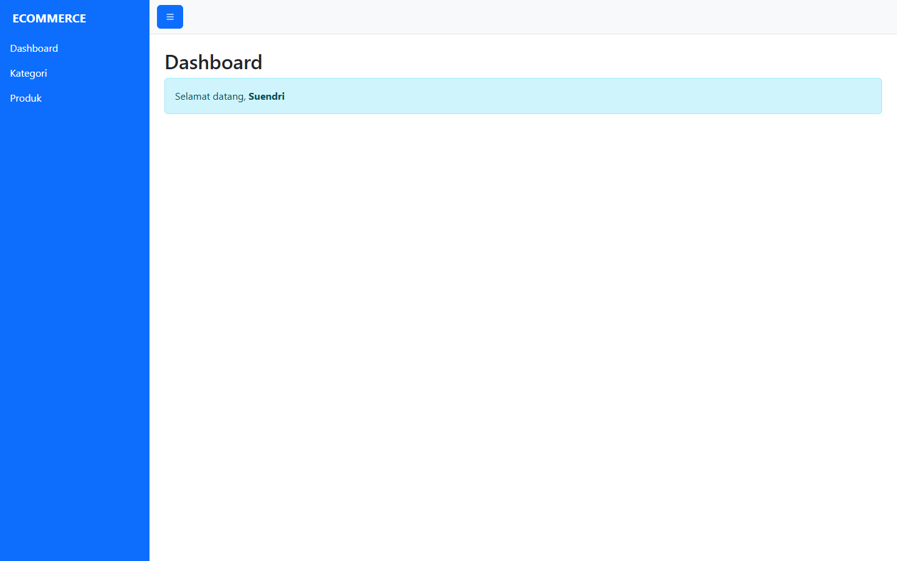
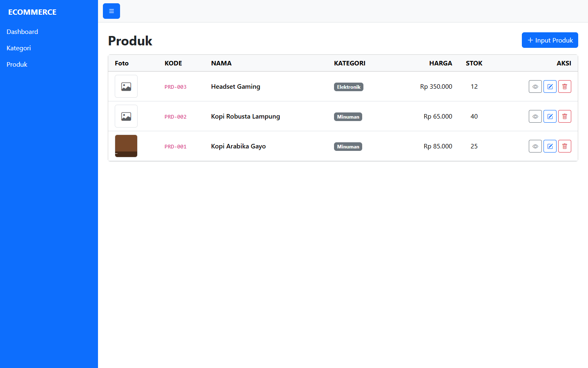
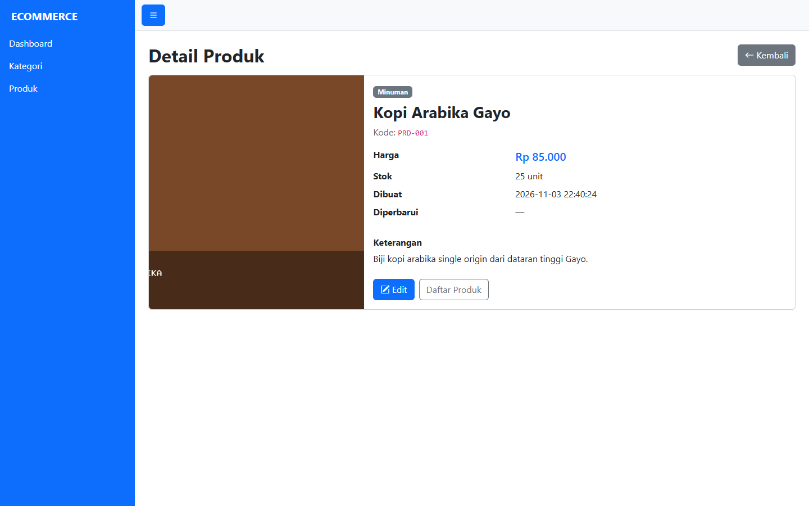
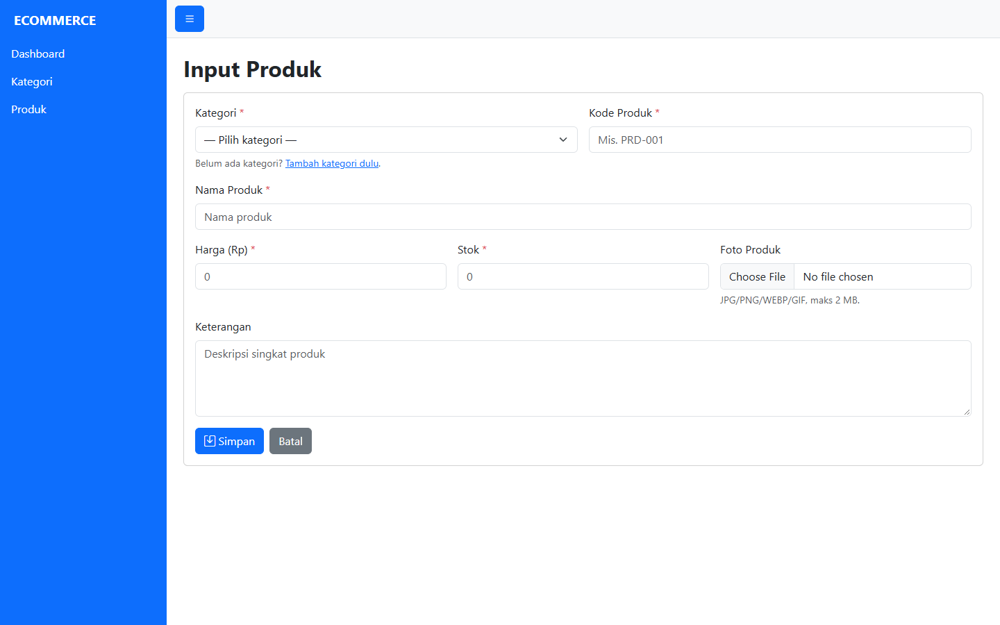
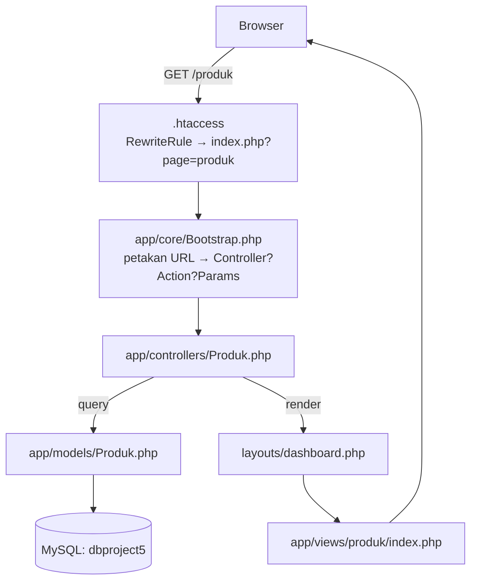
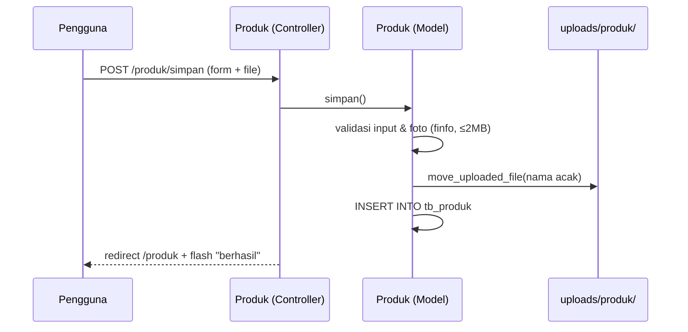

<div align="center">

# 🛒 E-Commerce MVC — PHP Native

**Project 5 · Pemrograman Berbasis Web Lanjutan**

Aplikasi **MVC buatan sendiri** (tanpa framework) untuk mengelola **Kategori** & **Produk**, lengkap dengan **unggah foto**, validasi, dan flash message.


</div>

---

## 📖 Deskripsi

Proyek ini membangun pola **MVC (Model–View–Controller)** dari nol: URL rapi dipetakan ke controller, controller memanggil model, dan view dirender di dalam layout. Tidak memakai framework apa pun — semuanya ditulis sendiri agar alurnya terlihat jelas.

Fokus utamanya adalah fitur **Produk** yang pada versi awal masih parsial (metode simpan/ubah dikomentari, kolom salah, tabel database belum ada, view kosong). Repo ini menyelesaikannya menjadi **CRUD penuh + unggah foto**.

## 📸 Tampilan

<table>
  <tr>
    <td width="50%"><br><sub>Dashboard</sub></td>
    <td width="50%"><br><sub>Daftar Produk</sub></td>
  </tr>
  <tr>
    <td width="50%"><br><sub>Detail Produk</sub></td>
    <td width="50%"><br><sub>Form Input Produk</sub></td>
  </tr>
</table>

## ✨ Fitur

### Kategori
- Daftar kategori, tambah, ubah

### Produk (lengkap)
- 📋 Daftar produk + nama kategori (JOIN) dalam tabel rapi dengan thumbnail
- ➕ Tambah produk + **unggah foto**
- 🔍 Halaman **detail** produk
- ✏️ Ubah produk (ganti foto → foto lama otomatis dibuang)
- 🗑️ Hapus produk (baris + file foto ikut terhapus)
- ✅ Validasi sisi server: kategori wajib & terverifikasi, kode unik, harga/stok ≥ 0
- 🖼️ Validasi gambar asli via `finfo` (JPG/PNG/WEBP/GIF, maks 2 MB), nama file acak
- 💬 **Flash message** sukses/gagal

## 🧱 Teknologi

| Lapisan | Teknologi |
| --- | --- |
| Bahasa | PHP 8.0+ (MVC buatan sendiri) |
| Database | MySQL / MariaDB (PDO, prepared statement) |
| Tampilan | Bootstrap 5 + Bootstrap Icons (aset lokal) |
| Paket PHP | `filp/whoops` (penampil error saat pengembangan) |
| Routing | `mod_rewrite` Apache (URL rapi) |

## 🏗️ Arsitektur



Alur unggah foto:



## 📁 Struktur Folder

```
project5/
├── index.php                 # Front controller
├── .htaccess                 # URL rapi
├── inc/
│   └── config.php            # URL dasar, autoload, session
├── app/
│   ├── core/
│   │   ├── Bootstrap.php     # Router URL → controller
│   │   ├── Controller.php    # Render view + layout
│   │   ├── Model.php         # Koneksi PDO
│   │   └── Error.php         # Halaman 404
│   ├── controllers/
│   │   ├── Index.php         # Halaman sambutan + contoh route
│   │   ├── Dashboard.php
│   │   ├── Kategori.php
│   │   └── Produk.php        # ← CRUD lengkap
│   ├── models/
│   │   ├── Kategori.php
│   │   └── Produk.php        # ← validasi, upload, CRUD
│   └── views/
│       ├── index/            # index, show, detail (contoh routing)
│       ├── dashboard/
│       ├── kategori/
│       └── produk/           # index, input, edit, detail
├── layouts/
│   ├── dashboard.php         # Layout utama (sidebar + flash)
│   ├── guest.php             # Layout alternatif sederhana
│   └── assets/               # Bootstrap, ikon, CSS, JS
├── uploads/
│   ├── .htaccess             # Blokir eksekusi skrip di folder upload
│   └── produk/               # Foto produk
├── vendor/                   # (tidak di-commit — composer install)
├── composer.json
└── database.sql              # tb_kategori + tb_produk
```

## ⚙️ Persyaratan

- **PHP 8.0+** dengan `pdo_mysql` dan `fileinfo`
- **MySQL / MariaDB**
- **Apache** dengan **`mod_rewrite` aktif** (XAMPP: aktif secara bawaan)
- **Composer** (untuk `filp/whoops`)
- Folder `uploads/` dapat ditulisi (writable)

## 🚀 Instalasi & Menjalankan

1. **Letakkan folder** di web root, mis. `C:\xampp\htdocs\project5`.

2. **Pasang dependensi PHP**:
   ```bash
   cd project5
   composer install
   ```

3. **Buat database** `dbproject5` di phpMyAdmin.

4. **Import** `database.sql` ke database tersebut (membuat `tb_kategori` & `tb_produk`).

5. **Sesuaikan koneksi** di `app/core/Model.php`:
   ```php
   new PDO("mysql:host=127.0.0.1;port=3307;dbname=dbproject5;charset=utf8mb4", "root", "")
   ```
   *(hapus `;port=3307` bila MySQL Anda di port 3306)*

6. **Sesuaikan URL dasar** di `inc/config.php`:
   ```php
   define("URL", "http://localhost/project5");
   ```

7. **Buka** `http://localhost/project5/`.

> Jika URL rapi (mis. `/project5/kategori`) tidak jalan, pastikan `mod_rewrite` aktif. Alternatifnya gunakan `index.php?page=kategori`.

## 🔐 Kredensial

Aplikasi ini **tidak memakai login** (versi tanpa autentikasi). Untuk versi ber-login, lihat project **MVC + Auth**.

## 🧭 Halaman

| URL | Keterangan |
| --- | --- |
| `/project5/` | Halaman sambutan |
| `/project5/dashboard` | Dashboard |
| `/project5/kategori` | Daftar kategori |
| `/project5/kategori/input` | Tambah kategori |
| `/project5/produk` | Daftar produk |
| `/project5/produk/input` | Tambah produk (dengan foto) |
| `/project5/produk/detail/{id}` | Detail produk |
| `/project5/produk/edit/{id}` | Ubah produk |

## 🗄️ Skema Database

**tb_kategori**: `kat_id`, `kat_nama`, `kat_keterangan`, `created_at`, `updated_at`

**tb_produk**: `produk_id`, `produk_id_kat` (FK → tb_kategori), `produk_kode` (unik), `produk_nama`, `produk_hrg`, `produk_keterangan`, `produk_stock`, `produk_photo`, `created_at`, `updated_at`

## 🧪 Pengujian yang Sudah Dilakukan

- ✅ Semua halaman (termasuk URL rapi) mengembalikan **HTTP 200**
- ✅ Tambah produk + **unggah foto** → baris DB & file dibuat
- ✅ Update **ganti foto** → foto lama terhapus, foto baru tersimpan
- ✅ Hapus produk → baris **dan** file foto terhapus
- ✅ Kode produk duplikat → pesan *"Kode produk sudah dipakai"* (bukan error mentah)
- ✅ Validasi ukuran/format gambar diuji dengan file nyata

## 🔧 Yang Diperbaiki dari Versi Awal

1. **Tabel `tb_produk` ditambahkan** ke `database.sql` (sebelumnya tidak ada, padahal dipakai model).
2. **Model Produk diperbaiki** — kolom `kat_*` yang salah diganti kolom produk; query simpan/ubah benar.
3. **Controller Produk dilengkapi** — metode simpan/edit/update yang tadinya dikomentari + tambah `hapus`/`detail`.
4. **View `edit.php` & `detail.php` dibuat** (sebelumnya file kosong); `index.php` dirapikan.
5. **Upload foto** ditambahkan beserta validasi & pembersihan file lama.
6. **Bug router** `Bootstrap::getRequestUri()` diperbaiki agar root URL tidak 404.
7. **Bug redirect** kategori (`/kategori/kategori` → `/kategori`) diperbaiki.
8. **Keamanan output** — escaping XSS pada seluruh view.

## 🩺 Troubleshooting

| Gejala | Solusi |
| --- | --- |
| `Class not found` / `vendor/autoload.php` | Jalankan `composer install` |
| Halaman 404 pada URL rapi | Aktifkan `mod_rewrite`; coba `index.php?page=produk` |
| Foto tidak muncul | Pastikan folder `uploads/produk/` ada & writable |
| `Table 'tb_produk' doesn't exist` | Import `database.sql` yang terbaru |
| Redirect aneh / URL salah | Periksa nilai `URL` di `inc/config.php` |

## 📄 Lisensi

Dirilis di bawah lisensi **[MIT](LICENSE)**.

## 🙏 Kredit

Berdasarkan materi praktikum **Pemrograman Berbasis Web Lanjutan** (kode awal oleh *Suendri*). Versi ini menyelesaikan fitur Produk dan memperbaiki sejumlah bug serta celah keamanan.
